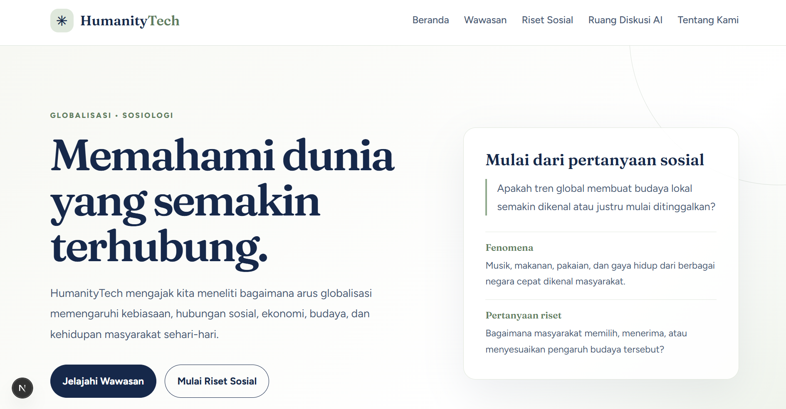
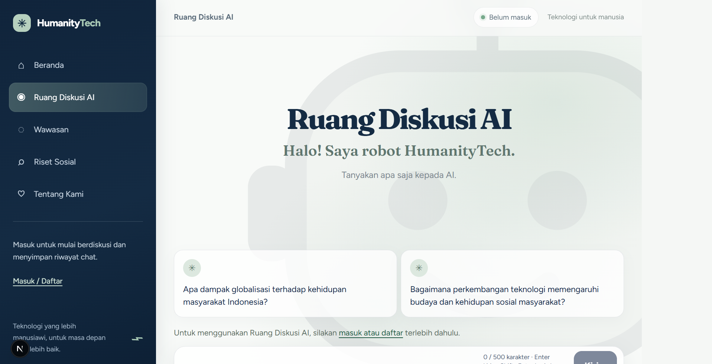

# HumanityTech

Inovasi Teknologi Human-Centric untuk Kesejahteraan Masyarakat.

## Cara menjalankan

Syarat: Node.js versi 18.18 or lebih baru 

```bash
npm install
npm run dev
```

## Tampilan Aplikasi





http://localhost:3000 / https://humanitytech.vercel.app/

## Struktur folder

- `app/` : halaman website (satu folder = satu halaman)
- `app/api/` : jalur aman ke AI dan database (tahap berikutnya)
- `components/` : potongan tampilan yang dipakai berulang
- `styles/` : CSS (warna, font, dan jarak ada di `variables.css`)
- `lib/` : pengaturan koneksi Supabase dan Gemini (tahap berikutnya)
- `data/` : isi awal seperti artikel
- `public/` : gambar, logo, dan ilustrasi robot
